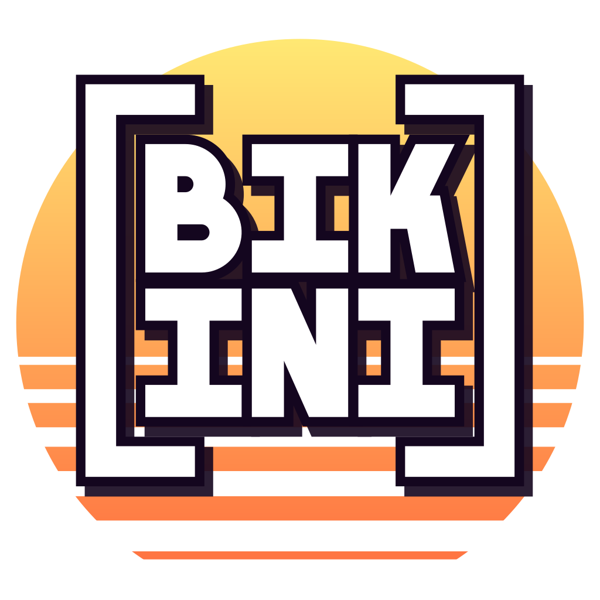

<p align="center">
  
</p>

# Bikini

[](https://github.com/partoska/bikini/releases/tag/v1.0.0)
[](LICENSE.txt)
[](https://github.com/partoska/bikini/actions/workflows/build.yml)
[](https://www.npmjs.com/package/@partoska/bikini)

Small, minimal INI library and query tool, in plain ISO C99.

- **bikini** queries and edits INI files from the command line, so that shell
  scripts and pipelines can read configuration without `sed` or `awk`.
- **libbikini** reads and writes the common INI dialect (without
  interpolation), keeps sections and keys in file order and never prints
  anything: errors live in the document.

## Features

- Queries for the whole document, one section, or one value, with quoting for
  names that contain dots.
- Lists of section or key names, one per line, for shell loops.
- Several files merged in order, later values replacing earlier ones.
- Setting and deleting keys and sections, printed or written back in place.
- Exit codes for scripts: `0` found, `1` not found, `2` usage or input error.
- Output of sections and documents is valid INI, ready for another `bikini`.
- A dependency-free C library behind it, with stream callbacks for any source.

## Supported Platforms

| OS      | Architectures                                |
| ------- | -------------------------------------------- |
| macOS   | Universal (Intel & Apple Silicon), macOS 11+ |
| Linux   | amd64, arm64, armhf (ARMv6+)                 |
| Windows | amd64, arm64                                 |

## Installation

### Homebrew (macOS, Linux amd64/arm64)

```bash
brew install partoska/tap/bikini
```

### Scoop (Windows)

```powershell
scoop bucket add partoska https://github.com/partoska/scoop-bucket
scoop install partoska/bikini
```

### npm (macOS, Linux amd64/arm64, Windows)

```bash
npm install -g @partoska/bikini
```

### Packages and binaries

Every [GitHub release](https://github.com/partoska/bikini/releases) ships a
macOS `.pkg` installer, Linux `.deb` (amd64, arm64, armhf) and `.rpm` (amd64,
arm64) packages, Windows `_setup.exe` (amd64, arm64) and `.msi` (amd64)
installers, `.tar.gz` and `.zip` archives, bare binaries, and a `SHA256SUMS`
file. The packages also hold `libbikini` with its headers and pkg-config file.
For example, on Raspberry Pi OS (32-bit):

```bash
sudo apt install ./bikini_<version>_linux_armhf.deb
```

### Build from source

Prerequisites: CMake 3.20+ and a C99 compiler (GCC, Clang, or MSVC).

```bash
git clone https://github.com/partoska/bikini && cd bikini
./build.sh
sudo ./install.sh
```

Without CMake, `make && sudo make install` builds and installs the tool and the
static library.

### Agent skill

An agent skill teaches AI coding agents how to drive the `bikini` CLI (queries,
quoting, listing, merging, editing, and exit codes). Its source is in
[`skills/bikini/`](skills/bikini/SKILL.md). Install it into your agent (Claude
Code, Codex, Cursor, and others) with:

```bash
npx skills add partoska/bikini
```

Every release also ships `bikini_<version>_skill.zip`, which can be uploaded as
a custom skill in Claude.

## Usage

```
bikini [OPTIONS] [QUERY] [FILE...]
```

Reads `FILE`, or standard input when `FILE` is missing or `-`, and prints
what `QUERY` selects:

| Query | Prints |
|---|---|
| `.` (default) | the whole document, normalized |
| `SECTION` | one section, as INI text |
| `SECTION.KEY` | the raw value of a key |

A whole section name wins over a split at the dot, and otherwise the key
follows the last dot, so `database.primary.max-connections` reads
`max-connections` from `[database.primary]`. Names with dots can be quoted: once a query contains a `"`,
only dots outside of quotes separate names, the last name is the key and the
others, joined by dots, the section. Within quotes `\"` and `\\` escape.

```sh
$ bikini server.port app.ini
8080
$ cat app.ini | bikini server
[server]
host = example.com
port = 8080
$ port=$(bikini server.port app.ini) || echo "no port"
$ bikini '"database.primary"."max-connections"' app.ini
100
$ bikini 'logging."handler.file"' app.ini
```

`-k` / `--keys` lists names instead, one per line: the sections of `.`, or
the keys of `SECTION`.

```sh
$ bikini -k . app.ini
server
database.primary
$ for key in $(bikini -k server app.ini); do ...; done
```

Several files are merged in order: a section repeated in a later file adds
its keys to the earlier one, and later values replace earlier ones. Repeats
within one file are still errors.

```sh
$ bikini server.port defaults.ini local.ini
```

Editing: `-s VALUE` / `--set VALUE` sets `SECTION.KEY` (adding the section
and the key when missing), `-d` / `--delete` deletes `SECTION` or
`SECTION.KEY`. The edited document goes to standard output, or with `-w` /
`--write` back to its file, which needs exactly one `FILE`. Deleting
something that is not there exits with `1`; the document is still printed,
but a `-w` leaves the file untouched.

```sh
$ bikini -w -s 9090 server.port app.ini
$ bikini -d server.debug app.ini > clean.ini
$ bikini -d -w client app.ini || echo "no [client]"
```

The file is rewritten in place, so it keeps its permissions and links.

Other options: `-i` / `--ignore-case` matches sections and keys ASCII
case-insensitively, `-h` / `--help`, `-V` / `--version`.

Exit status: `0` found, `1` not found, `2` usage or input error (including
syntax errors in the INI text, reported with their line on standard error).

## Library

```c
#include <bikini.h>

BKIni *ini = bkInit (BK_FNONE);
if (bkLoad (ini, "app.ini") != BK_OK)
  {
    fprintf (stderr, "%s\n", bkError (ini)->message);
  }
const char *port = bkGet (ini, "server", "port");

bkSet (ini, "server", "port", "9090");
bkSave (ini, "app.ini");
bkDestroy (ini);
```

The dialect:

```ini
; comment            Comments take a whole line and start with ; or #.
[section]            Section names are case-sensitive by default.
key = value          Either = or : separates key and value, both of
key: value           which are trimmed.
multi = first        Lines indented deeper than their key continue the
  second             value, joined with a newline.
```

Streams go through callbacks, so any source works: `bkRead` pulls text from
a `BKReadFn` (standard input, a socket, memory) and `bkWrite` pushes it to a
`BKWriteFn`; `bkLoad` and `bkSave` are the file versions.

```c
static BKSize
readStdin (BKVoid *user, BKChar *data, BKSize size)
{
  BKSize n = fread (data, 1, size, stdin);
  return n == 0 && ferror (stdin) ? BK_READ_ERROR : n;
}

bkRead (ini, readStdin, NULL);
```

`bkRemove` and `bkSectionRemove` delete a key or a whole section. Repeated
sections and repeated keys within a section are errors. See
`src/lib/inc/bikini.h` for the whole API.

Link with `pkg-config --cflags --libs bikini`, or in CMake add this
repository with `add_subdirectory` and link the `bikini` target.

## Building

Requirements: a C99 compiler and CMake 3.20 or later.

```sh
./build.sh                # Release build into ./build
./build.sh -d -t          # Debug build with tests
./build.sh -s -t          # Sanitizers (address, undefined; integer on Clang)
./build.sh -p             # Packages into dist/ (CPack)
./test.sh                 # Run the registered tests (does not build)
./install.sh              # cmake --install: bin/bikini, lib/libbikini.a,
                          # include/, pkg-config, docs
```

CMake options: `BUILD_SHARED_LIBS` (shared `libbikini`), `WITH_CLI` (default
on), `WITH_TESTS`, `WITH_SANITIZERS`. `make help` lists the targets and options
of the plain `Makefile`.

On Windows, build with MSVC (Visual Studio 2015 or later) or MinGW-w64; the
scripts run in Git Bash or MSYS2, `test_cli` needs their `sh`. Executables and
DLLs go to `build/bin`, and `./build.sh -p` makes a ZIP, plus NSIS and WiX
installers when `makensis` and the WiX toolset are installed. With MSVC the
library is named `libbikini` (`libbikini.lib`, `libbikini.dll`), and
sanitizers are not supported. The `bikini` tool reads and writes its standard
streams in binary mode, so it prints LF line endings as it does elsewhere.

## Contributing

Contributions are welcome — see [CONTRIBUTING.md](CONTRIBUTING.md). To report a
security issue, follow [SECURITY.md](SECURITY.md).

## License

This project is licensed under the [MIT License](LICENSE.txt).

## Contact

Project website: <https://lab.partoska.com/bikini>. You can contact the
author(s) via email at ask <at> partoska.com.

## Copyright

Copyright (C) 2026 Fabrika Charvat s.r.o. All rights reserved.
Developed by Partoska Laboratory team, &lt;<https://lab.partoska.com>&gt;
